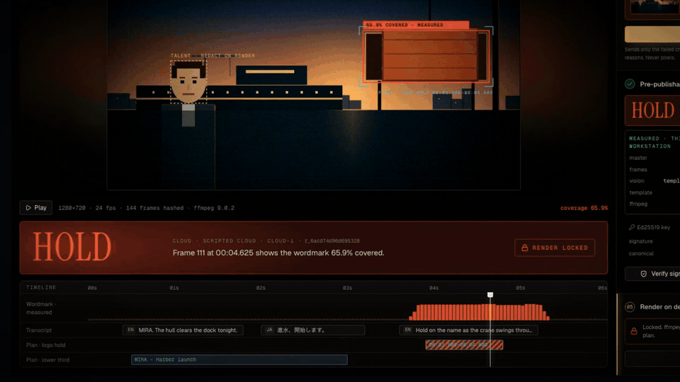
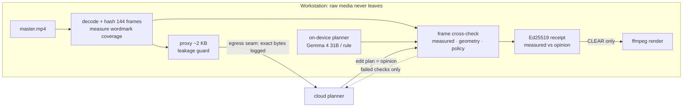

# BrandForward

**Pre-publishability verification for unreleased video. Raw footage stays on the workstation. Cloud models plan edits from a 2 KB metadata proxy. Every claim they make is checked against decoded frames before anything renders, and the result is a signed receipt.**

<p align="center">
  <a href="https://github.com/ankitshah009/brandforward/releases/download/v0.2.0/brandforward-demo.mp4">
    
  </a>
  <br>
  <b><a href="https://github.com/ankitshah009/brandforward/releases/download/v0.2.0/brandforward-demo.mp4">▶ Watch the 95-second narrated demo (1080p)</a></b>: recorded from the real console against the running engine, composed in Remotion, narrated and sound-designed in Edits. The cloud plan uses the labeled scripted provider; the frame measurements, receipts, render and the on-device Gemma 4 31B plan are real.
</p>

## Your personal agent for footage you can't upload

### Why it works as a personal agent

- **It uses frontier models without uploading your footage.** Planners see a ~2 KB anonymized proxy. One egress seam builds, guards, and logs the exact request bytes, and raw media sent stays at 0 B.
- **It trusts neither itself nor the cloud.** Every claim, and everything an edit implies, is checked against your decoded frames. A wrong claim comes back as HOLD with the exact frame, its SHA-256, and the percentage covered.
- **It fixes its own mistakes.** *Revise with evidence* sends the planner only the failed checks (ids, intervals, numbers, reasons, never pixels) and gets a corrected plan.
- **It keeps working offline.** Drop the link and planning moves to Gemma 4 31B on your machine through Ollama. Nothing is transmitted.
- **It hands you proof.** The Ed25519 receipt keeps measured facts apart from model opinions. Anyone can verify it offline with `python -m brand_forward.verify`. Nothing renders until a valid receipt says CLEAR.

### Try it in 3 minutes

1. `git clone https://github.com/ankitshah009/brandforward && cd brandforward`
2. Terminal 1: `cd engine && uv run python -m brand_forward`
3. Terminal 2: `cd web && npm install && npm run dev`, then open http://localhost:3000 and choose **Run the harbor-launch job**.
4. Press **N** to walk the demo: Send proxy → Cross-check & sign (HOLD: frame 111, wordmark 65.9% covered) → Revise with evidence → Cross-check & sign (CLEAR) → Render proof cut → Verify signature → Tamper test → Drop link → Plan on device → Cross-check & sign (CLEAR).
5. Optional: pull a 27B–32B-class model into Ollama for on-device planning; without one, a deterministic rule planner runs. Put `OPENAI_API_KEY=` in a repo-root `.env.local` and pick **Live** to use a real cloud planner.
6. Verify a downloaded receipt offline: `cd engine && uv run python -m brand_forward.verify receipt.json --public-key <public_key from GET /health>`

### Day to day

A creator, founder, or small team brings unreleased footage and asks for a cut: a logo reveal, a lower third, redactions. The agent plans with cloud or local weights, and the workstation checks the plan against the frames. You get a signed receipt to send to a client, a platform, or legal, and then the render.

Today the job is a synthetic harbor-launch shot drawn by ffmpeg. Ingesting arbitrary footage with SAM 3.1 tracking and Whisper transcription is the ThinkStation P8 step (see [From this build to a ThinkStation P8](#from-this-build-to-a-thinkstation-p8)).

## The problem

Media teams want AI agents to cut, caption, and brand their footage. Three things stop that in production.

1. **Upload is the wrong boundary.** Cloud video tools want the raw footage: gigabytes of unreleased product shots, talent who has not been announced, embargoed launches. Sending them breaks privacy, compliance, and often contracts. It is also slow.
2. **Cloud models make confident claims about pixels they never checked.** A planner reads "hold on the name" in the transcript and schedules a logo reveal at 00:04.2. At 00:04.2 the logo is behind a crane load. Timestamps drift, objects are assumed, and the cut ships with the mistake.
3. **Nobody can prove what was checked.** When legal asks "was the talent blurred, was the logo visible, which model decided?", the answer is a log line, not evidence.

BrandForward moves the trust boundary. Pixels never leave the workstation. Models only give **opinions**. The workstation **measures**, and it signs what it measured.

## What it does

The demo job is `harbor-launch`: a 6-second launch shot of the MIRA hull. The talent is unreleased, and a crane load swings in front of the MIRA wordmark partway through.

1. **Ingest and measure, on device.** ffmpeg decodes and SHA-256-hashes all 144 frames. Vision compares the wordmark region of every frame with the brand template and records pixel coverage in integer basis points. In this shot the wordmark is covered from `00:03.708` to `00:05.333`, at up to 65.9 %.
2. **Seal the proxy.** The only document allowed to leave is a ~2 KB proxy: track ids, visibility spans, redaction flags, transcript lines, and one frame hash per second. A leakage guard rejects anything that looks like pixels, file bytes, paths, or URLs. The master is 30.7 MB here (6 s of 720p) and gigabytes in production.
3. **Cloud plan.** The proxy goes through a single egress seam that records the exact request bytes, their size, and their SHA-256. The cloud returns an edit plan: a logo hold, a lower third, face blur, and the visibility claims it relied on.
4. **Frame cross-check → HOLD.** The workstation never trusts the plan's own claims alone. Each edit implies checks of its own:
   - **measured**: is the wordmark visible across the hold interval, frame by frame?
   - **geometry**: does the lower third stay clear of the face and the wordmark?
   - **policy**: is a talent flagged for redaction actually blurred?

   The cloud's hold at `00:03.900–00:04.800` fails. Frame 111 shows the wordmark 65.9 % covered.
5. **Revise or fail over.** *Revise* sends the planner only the failed checks (ids, intervals, numbers, reasons, never pixels) and gets a corrected plan. *Drop link* never touches the network: the same planning step runs on device on Gemma 4 31B through Ollama, or on a deterministic rule planner if no local weight is loaded. A cloud error or an answer outside the schema fails over the same way.
6. **CLEAR, and a signed receipt.** The receipt is Ed25519 over canonical JSON. It keeps two sections apart:
   - `measured`: asset hash, frame count, vision method, template hash, ffmpeg version.
   - `opinion`: proposal hash, provider, model, and the hash of the proxy the model saw.

   `checks` joins the two, with frame indexes and frame hashes as evidence. The same inputs always produce the same bytes. Change one field and verification fails; the console has a tamper button to show it.
7. **Gated render.** ffmpeg renders the plan (face pixelation, lower third, logo hold) only if all of these hold:
   - a receipt exists for this exact proposal;
   - its signature verifies against the pinned key;
   - its verdict is CLEAR;
   - the proposal hash matches the one that was signed;
   - the master on disk still matches the signed hash;
   - a fresh cross-check still agrees.

   Anything else returns `409`.

## Why it matters: from build day to real deployment

### A personal agent for footage you cannot upload

A founder with an unreleased product film, a freelancer with client rushes, a journalist with an embargoed interview, a family with private video: each wants an editing agent, and none of them should hand the raw files to a cloud service to get one. With BrandForward the loop is:

1. Drop footage on the workstation. It is decoded, hashed, and measured there.
2. The agent plans the cut with a frontier model (it sees only the proxy) or with on-device weights.
3. The workstation checks the plan against decoded frames. A wrong claim comes back HOLD with the frame that disproves it, and the planner revises.
4. The result is a signed receipt the person can hand to a client, a platform, or legal.
5. ffmpeg renders only what the receipt cleared.

### Why a personal agent needs this architecture

An agent that acts on someone's private media needs four properties. Each one exists in this repo as code, not policy text.

| Property | Where it lives |
| --- | --- |
| **One egress boundary.** A single seam builds the request, runs the leakage guard, and logs the exact bytes and their SHA-256 before anything is sent. A down link never reaches the network. | `engine/brand_forward/cloud.py`, `guard.py` |
| **Claims grounded in measurement.** Plans are opinions. Every claim, and every check an edit implies (visibility, lower-third geometry, redaction policy), is tested against per-frame pixel coverage. | `crosscheck.py`, `vision.py` |
| **Self-correction without leaking.** On HOLD, only the failed checks (ids, intervals, percentages, reasons) go back to the planner. Never pixels. | `planner.py` (`feedback`, `messages`), `pipeline.research(revise=...)` |
| **Works offline.** Link down, cloud error, or an answer outside the schema all fail over to Gemma 4 31B through Ollama, then to a deterministic rule planner. | `pipeline._local_plan`, `llm.py` |
| **Accountable output.** The Ed25519 receipt separates `measured` (computed from files) from `opinion` (what a model proposed). The render refuses unless that receipt verifies, says CLEAR, and still matches the plan and the master on disk. | `receipt.py`, `pipeline.render` |

### From this build to a ThinkStation P8

| | Built today | Next, on the P8 / RTX PRO 6000 |
| --- | --- | --- |
| Vision | Template-diff pixel coverage of the wordmark on every decoded frame | SAM 3.1 tracking of arbitrary objects and faces behind the same `analyze` output |
| Speech | Fixture transcript (en, ja) | Whisper on device |
| Local reasoning | Gemma 4 31B via Ollama on an M5 Max | 30B+ weights resident beside vision and ASR in 96 GB |
| Media | Synthetic 1280×720 master drawn by ffmpeg | Camera originals, 4K, long form |
| Receipts | Ed25519 over canonical JSON; anyone can verify offline with `python -m brand_forward.verify receipt.json --public-key …` | HSM-backed key, public key published per workstation |
| Agent surface | HTTP API plus an MCP tool manifest (`engine/mcp/manifest.json`) over the same functions | Served over MCP so any agent framework calls the same tools |
| Integrations | None | NLE export, DAM ingest, legal review queue |

### Who else it unblocks

Brand and compliance teams that need proof a logo or a face was handled correctly. Agencies working on client footage under NDA. Newsrooms with embargoed material. Any enterprise that wants AI video editing but cannot let raw assets leave its machines.

### What works in this repo today

- ffmpeg master generation and SHA-256 of every decoded frame (144 frames, deterministic)
- Pixel-measured wordmark occlusion per frame, in integer basis points
- A ~2 KB anonymized proxy as the only egress, behind a leakage guard
- Scripted cloud planner for repeatable demos, live OpenAI-compatible planner, schema validation, and failover
- On-device planning with Gemma 4 31B through Ollama, with a rule-planner fallback
- Revise-with-evidence loop from HOLD to CLEAR
- Ed25519 receipts, deterministic for the same inputs, with a tamper test in the console and a standalone offline verifier (`python -m brand_forward.verify`)
- ffmpeg render gated on a valid CLEAR receipt (face pixelation, lower third, logo hold)
- A Next.js 16 console against the live engine: real master playback with measured overlays, per-frame coverage timeline, egress ledger with the exact request bytes, evidence frames, receipt split into measured and opinion, gated render. Design explored in Lovable, then ported onto the live engine (Tailwind v4, Geist, Instrument Serif, Framer Motion). Press `N` to step through the demo.
- A Remotion demo video built from a Playwright capture of the real console (`demo/`)
- 16 engine tests, run in parallel

## The boundary



The arrows leaving the workstation carry only the proxy and, on a revision, the failed checks. `GET /jobs/{id}/egress/{seq}` returns the exact request body that was built for each call, whether or not it was sent.

## What is real on this build, and what is a stand-in

This build runs on an Apple M5 Max laptop, not the ThinkStation P8. The camera original is not on this machine, so the master is a synthetic harbor shot that ffmpeg draws on device: hull, talent, the MIRA wordmark panel, and a swinging crane load. Nothing downstream is told where the occlusion is. Vision measures it from decoded pixels.

| Stage | This build | On the ThinkStation P8 |
| --- | --- | --- |
| Media: generate, decode, hash, render | **Real.** ffmpeg, libx264, deterministic output | Same, 4K masters, NVENC |
| Wordmark visibility | **Real measurement.** Per-frame template diff against the brand template (`template-diff.v1`) | SAM 3.1 tracks |
| Talent face and hull boxes | Scene layout from the generator | SAM 3.1 detections |
| Transcript (en, ja) | Fixture | Whisper on device |
| On-device planner | **Real.** Gemma 4 31B (Q8) via Ollama when present; deterministic rule planner otherwise | 30B+ open weights on Blackwell |
| Cloud planner | Scripted answer by default, labeled as scripted, never transmitted. Optional live OpenAI-compatible endpoint (needs a valid key) | Frontier API |
| Egress ledger and leakage guard | **Real** | Same |
| Cross-check and receipts | **Real.** Ed25519, canonical JSON, pinned key | Same, HSM-backed key |

The console shows the same per-stage state, read from `GET /nodes`, so nothing on screen claims more than the engine ran.

## Why it needs an RTX PRO 6000

Everything that touches pixels has to run next to the footage, at the same time:

- a 30B+ planner held in memory for failover (the Q8 Gemma 4 31B used here is about 33 GB);
- SAM 3.1 tracking dense video;
- Whisper transcribing multilingual audio;
- 4K decode and encode.

On a 24 GB card these stages take turns and evict each other's weights and KV cache. With 96 GB they stay resident together, and frame-accurate verification stays fast enough to sit in the editing loop instead of after it.

## Quickstart

Requirements: [uv](https://docs.astral.sh/uv/) (the engine pins Python 3.15 in `engine/.python-version`; uv installs it), ffmpeg with `drawtext` (libfreetype), Node 20+. Optional: [Ollama](https://ollama.com) with a 27B to 32B-class model pulled.

```bash
# engine on 127.0.0.1:8787
cd engine
uv run python -m brand_forward

# console on http://localhost:3000 (second terminal)
cd web
npm install
npm run dev
```

Open http://localhost:3000 and choose **Run the harbor-launch job**. In the console, press `N` for the next step (Send proxy → Cross-check & sign → Revise with evidence → Render → Verify → Tamper test → Drop link → Plan on device), space to play, arrow keys to scrub.

Verify a downloaded receipt with nothing but the receipt and the workstation's public key (shown in the console and at `GET /health`):

```bash
cd engine
uv run python -m brand_forward.verify ~/Downloads/r_….json --public-key <base64>
```

Tests:

```bash
cd engine
uv run --extra dev pytest -n auto
```

The tests use a temporary data directory, the rule planner, and the scripted cloud. No network and no GPU.

### Configuration

Environment variables, or `KEY=VALUE` lines in a repo-root `.env.local` (gitignored, read by the engine at start):

| Variable | Default | Purpose |
| --- | --- | --- |
| `BRAND_FORWARD_PORT` | `8787` | Engine port (binds `127.0.0.1`). |
| `BRAND_FORWARD_DATA` | `engine/data` | Jobs, frames, renders, and the workstation signing key. |
| `BRAND_FORWARD_ENGINE` | `http://127.0.0.1:8787` | Engine origin the web console proxies to. |
| `BRAND_FORWARD_LOCAL` | `auto` | `rule` forces the deterministic planner and skips Ollama. |
| `BRAND_FORWARD_LOCAL_MODEL` | auto-detect | Ollama model tag for on-device planning. |
| `BRAND_FORWARD_OLLAMA` | `http://127.0.0.1:11434` | Ollama endpoint. |
| `BRAND_FORWARD_CLOUD_URL` | `https://api.openai.com/v1` | OpenAI-compatible base URL for `provider: live`. |
| `BRAND_FORWARD_CLOUD_MODEL` | `gpt-5-mini` | Cloud model. |
| `BRAND_FORWARD_CLOUD_KEY` / `OPENAI_API_KEY` | none | Cloud key. Without one, a live request fails over on device. |
| `BRAND_FORWARD_FONT` | system serif | Font file for the wordmark and lower third. |

## API

`contracts/openapi.yaml` is the HTTP contract. The core calls:

```bash
E=http://127.0.0.1:8787
JOB=$(curl -s -X POST $E/jobs -H 'content-type: application/json' -d '{}' | jq -r .id)
curl -s $E/jobs/$JOB/proxy | wc -c                                   # ~2 KB
curl -s -X POST $E/jobs/$JOB/research -H 'content-type: application/json' -d '{}'               # scripted cloud plan
curl -s -X POST $E/jobs/$JOB/receipt  -H 'content-type: application/json' -d '{"proposal_id":"cloud-1"}'   # HOLD
curl -s -X POST $E/jobs/$JOB/research -H 'content-type: application/json' -d '{"link":"down"}'  # on-device plan
curl -s -X POST $E/jobs/$JOB/receipt  -H 'content-type: application/json' -d '{"proposal_id":"local-1"}'   # CLEAR
curl -s -X POST $E/jobs/$JOB/render   -H 'content-type: application/json' -d '{"proposal_id":"local-1"}'   # proof.mp4
```

The same stage functions are exposed as MCP tools (`engine/mcp/manifest.json`): `track_frames`, `transcribe`, `reason_local`, `export_proxy`, `verify_proposal`, `sign_receipt`.

## Layout

```
engine/      FastAPI engine and MCP tools (Python, uv)
  brand_forward/
    scene.py       synthetic master: geometry and ffmpeg filter graph
    media.py       ffmpeg: generate, frame hashes, decode regions, render
    vision.py      per-frame wordmark coverage, measured spans
    planner.py     edit-plan schema, prompts, scripted and rule planners
    llm.py         OpenAI-compatible cloud and Ollama clients (stdlib HTTP)
    cloud.py       the egress seam and ledger
    guard.py       leakage guard for anything that leaves
    crosscheck.py  measured, geometry, policy, and layout checks
    receipt.py     canonical JSON and Ed25519 receipts
    pipeline.py    job stages; server.py is the HTTP API
  tests/
web/         Next.js console (proxies /api/* to the engine)
fixtures/    job fixtures: transcript and scripted cloud answers
contracts/   OpenAPI contract
infra/       optional node probe for GPU hosts
```

## License

MIT. See [LICENSE](LICENSE).
